### Hi there 👋

I'm Marcel and GitHub is - at times - my second home.

<!--
**marcelstoer/marcelstoer** is a ✨ _special_ ✨ repository because its `README.md` (this file) appears on your GitHub profile.

Here are some ideas to get you started:

- 🔭 I’m currently working on ...
- 🌱 I’m currently learning ...
- 👯 I’m looking to collaborate on ...
- 🤔 I’m looking for help with ...
- 💬 Ask me about ...
- 📫 How to reach me: ...
- 😄 Pronouns: ...
- ⚡ Fun fact: ...
-->

### :octocat: Some statistics

<!-- https://github.com/anuraghazra/github-readme-stats -->

### :zap: Recent Activity

<!--START_SECTION:activity-->
1. 🔒 Closed issue [#421](https://github.com/ThingPulse/esp8266-oled-ssd1306/issues/421) in [ThingPulse/esp8266-oled-ssd1306](https://github.com/ThingPulse/esp8266-oled-ssd1306)
2. 🗣 Commented on [#432](https://github.com/ThingPulse/esp8266-oled-ssd1306/pull/432#issuecomment-6542397352) in [ThingPulse/esp8266-oled-ssd1306](https://github.com/ThingPulse/esp8266-oled-ssd1306)
3. ❗ Opened issue [#433](https://github.com/ThingPulse/esp8266-oled-ssd1306/issues/433) in [ThingPulse/esp8266-oled-ssd1306](https://github.com/ThingPulse/esp8266-oled-ssd1306)
4. 🗣 Commented on [#8859](https://github.com/dependency-check/DependencyCheck/issues/8859#issuecomment-6419272150) in [dependency-check/DependencyCheck](https://github.com/dependency-check/DependencyCheck)
5. 🗣 Commented on [#8859](https://github.com/dependency-check/DependencyCheck/issues/8859#issuecomment-6416296112) in [dependency-check/DependencyCheck](https://github.com/dependency-check/DependencyCheck)
6. 🎉 Merged PR [#1300](https://github.com/mc1arke/sonarqube-community-branch-plugin/pull/1300) in [mc1arke/sonarqube-community-branch-plugin](https://github.com/mc1arke/sonarqube-community-branch-plugin)
7. 🗣 Commented on [#7569](https://github.com/dependency-check/DependencyCheck/issues/7569#issuecomment-6132206679) in [dependency-check/DependencyCheck](https://github.com/dependency-check/DependencyCheck)
8. 🔒 Closed issue [#92](https://github.com/marcelstoer/nodemcu-pyflasher/issues/92) in [marcelstoer/nodemcu-pyflasher](https://github.com/marcelstoer/nodemcu-pyflasher)
9. 🗣 Commented on [#7569](https://github.com/dependency-check/DependencyCheck/issues/7569#issuecomment-6129122130) in [dependency-check/DependencyCheck](https://github.com/dependency-check/DependencyCheck)
10. 🎉 Merged PR [#9214](https://github.com/github/advisory-database/pull/9214) in [github/advisory-database](https://github.com/github/advisory-database)
11. 🗣 Commented on [#1335](https://github.com/MacDownApp/macdown/issues/1335#issuecomment-5978800775) in [MacDownApp/macdown](https://github.com/MacDownApp/macdown)
12. ❌ Closed PR [#3](https://github.com/marcelstoer/sonarqube-community-branch-plugin/pull/3) in [marcelstoer/sonarqube-community-branch-plugin](https://github.com/marcelstoer/sonarqube-community-branch-plugin)
13. 🎉 Merged PR [#2](https://github.com/marcelstoer/sonarqube-community-branch-plugin/pull/2) in [marcelstoer/sonarqube-community-branch-plugin](https://github.com/marcelstoer/sonarqube-community-branch-plugin)
14. 💪 Opened PR [#3](https://github.com/marcelstoer/sonarqube-community-branch-plugin/pull/3) in [marcelstoer/sonarqube-community-branch-plugin](https://github.com/marcelstoer/sonarqube-community-branch-plugin)
15. 💪 Opened PR [#2](https://github.com/marcelstoer/sonarqube-community-branch-plugin/pull/2) in [marcelstoer/sonarqube-community-branch-plugin](https://github.com/marcelstoer/sonarqube-community-branch-plugin)
16. 💪 Opened PR [#1](https://github.com/marcelstoer/sonarqube-community-branch-plugin/pull/1) in [marcelstoer/sonarqube-community-branch-plugin](https://github.com/marcelstoer/sonarqube-community-branch-plugin)
17. 🗣 Commented on [#8773](https://github.com/dependency-check/DependencyCheck/issues/8773#issuecomment-5451526931) in [dependency-check/DependencyCheck](https://github.com/dependency-check/DependencyCheck)
18. ℹ️ Unlabeled issue [#8773](https://github.com/dependency-check/DependencyCheck/issues/8773) in [dependency-check/DependencyCheck](https://github.com/dependency-check/DependencyCheck)
19. 🗣 Commented on [#8772](https://github.com/dependency-check/DependencyCheck/issues/8772#issuecomment-5450347262) in [dependency-check/DependencyCheck](https://github.com/dependency-check/DependencyCheck)
20. 🗣 Commented on [#8773](https://github.com/dependency-check/DependencyCheck/issues/8773#issuecomment-5450333095) in [dependency-check/DependencyCheck](https://github.com/dependency-check/DependencyCheck)
<!--END_SECTION:activity-->

